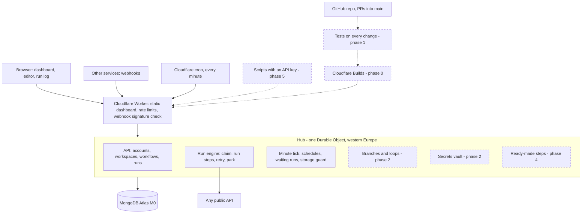

# Knotwork system plan

The plan for taking [[Knotwork]] from a working engine to a full product, written 2026-11-09 at Gigi's request. Visual version: https://claude.ai/artifact/1A7TYNCUNb9LL2yK1hLHKe (private to Gigi)

**Where it stands (2026-11-10):** version 1.0.0 is live. 35 of 38 capabilities are built and live, 1 is half done (the case study waits in gigiberidze.com PR #7), 2 are left for later (an "on failure" step, a feed-watch trigger). The tables and phases below are the plan as written on 2026-11-09. Every phase stays on free plans ([[ADR-0003 Knotwork runs on the Cloudflare free plan]]).

## Architecture
The shape stays the same from today to the finished product. New features go inside the hub and the dashboard.

A run moves through `queued → running → (waiting →) succeeded | failed | stopped`.

## Feature map

### Triggers
| Capability | Status | Phase |
|---|---|---|
| Run by hand with test input | Done |  |
| Webhook with a private, signed URL | Done |  |
| Schedule (cron, UTC, every 5 minutes at most) | Done |  |
| Check the sender's signature (GitHub, Stripe) | Built, PR #10 | 2 |
| Watch a feed or a page for new items | To build | 4 |

### Steps
| Capability | Status | Phase |
|---|---|---|
| HTTP request to any public API | Done |  |
| Transform, filter, delay, log | Done |  |
| Templates that pass data between steps | Done |  |
| Secrets per workspace (API keys kept out of the workflow) | Built, PR #10 | 2 |
| If / else branches | Built, PR #10 | 2 |
| Loop over a list | Built, PR #10 | 2 |
| Ready-made steps: Slack, Discord, Telegram, GitHub | Merged ([PR #7](https://github.com/GigiBeridzeAxal/knotwork/pull/7)), live from the next deploy | 4 |

### Engine
| Capability | Status | Phase |
|---|---|---|
| Runs save their place after every step | Done |  |
| Retries with backoff, delays up to a week | Done |  |
| One stuck run can't hold up the others | Done |  |
| Fair limits per account and a storage guard | Done |  |
| Run a past run again | Built, PR #10 | 2 |
| Tell me when a workflow fails | To build | 2 |

### Editor and dashboard
| Capability | Status | Phase |
|---|---|---|
| Step-by-step editor | Done |  |
| Home dashboard, run history and run log | Done |  |
| Two people saving at once: nothing lost | Done |  |
| Starter templates | Done (9 templates, gallery at `/templates`) | 3 |
| Visual canvas editor | Done | 3 |
| Test one step without running everything | Done | 3 |
| Version history, import and export | Done | 3 |

### Accounts and teams
| Capability | Status | Phase |
|---|---|---|
| Sign up, log in, demo account | Done |  |
| Workspaces (Personal plus 5 more) | Done |  |
| Change password, delete account | Done |  |
| Get back in without email (recovery codes) | Built, merged 2026-11-09, not deployed yet | 5 |
| Invite people to a workspace, with roles | Built, merged 2026-11-09, not deployed yet | 5 |
| API keys and a public API | Built, merged 2026-11-09, not deployed yet | 5 |

### Running it
| Capability | Status | Phase |
|---|---|---|
| Free plans only, measured in production | Done |  |
| Code merged into main | Partly | 0 |
| Deploys by itself on merge | To build | 0 |
| Tests run on every change | To build | 1 |
| Browser scenarios on Chromium, Firefox and WebKit | Partly | 1 |
| Alert when the live site breaks | To build | 1 |
| Docs, and a case study on gigiberidze.com | Partly (PRs open) | 6 |

## Phases
Each phase ends with something that can be opened and clicked.

### Phase 0: land what is built, stop deploying by hand (done 2026-11-10, Atlas role still open)
- Connect the repo to Workers Builds so a merge into `main` deploys itself (the same setup as [[gigiberidze.com]]). The Worker keeps its secrets across deploys.
- Done 2026-11-09: PR #2 and #3 merged. Done 2026-11-10: Builds connected; the first automatic deploy (`ea05146`, version 1.0.0) shipped phases 1 to 6.
- Merge PR #2, then PR #3. The first automatic deploy also ships `1b5a0e5` and `ee4c9c6`.
- Narrow the Atlas user to `readWrite` on `knotwork` ([[MongoDB Atlas]]). Check a full day of Durable Object usage.
- **Done when:** `main` matches the live site and a merged PR is live minutes later with nobody typing.
- **Needs from Gigi:** one OK to change the Cloudflare and Atlas settings through the browser ([[Working agreements]]). No commands.

### Phase 1: a safety net (done 2026-11-09, PR #4)
CI lives in `.github/workflows/ci.yml` and `live-check.yml`; scenarios in the repo's `e2e/`. CI runs on `ubuntu-22.04` because MongoDB 8 refuses to start on the 6.19 kernel of newer runners.
- GitHub Actions on every PR: type-check, unit tests, engine tests against a throwaway MongoDB.
- The 11 browser scenarios on Chromium, Firefox and WebKit in Actions ([[Browser scenario testers skill]]).
- A scheduled check of the live site that opens an issue when sign-in or a demo run fails.
- Fix the demo workflow "Retry and recover".
- **Done when:** a broken change is stopped before it merges, and a broken live site reports itself.

### Phase 2: engine power
- Secrets per workspace, encrypted in the database, used as `{{ secrets.NAME }}`, never shown in logs.
- If / else and loop steps that hold their own steps.
- Webhooks that check the sender's signature (GitHub, Stripe); run a past run again.
- An "on failure" step so a workflow can report that it broke.
- **Done when:** one workflow takes a signed GitHub webhook, branches, loops over a list and posts to a chat with a stored secret.
- **State 2026-11-09:** built in knotwork [PR #10](https://github.com/GigiBeridzeAxal/knotwork/pull/10), except the "on failure" step, which was left out on purpose and stays on the roadmap. The done-when flow is covered by tests with a stubbed chat service; it has not been run against real GitHub and Slack yet. Decisions: [[ADR-0015 Knotwork runs nested steps as a flat program]], [[ADR-0016 Knotwork secrets are encrypted with a key made from the pepper]]. How to connect a service: [[Set up a signed webhook in Knotwork]].

### Phase 3: the canvas
- A visual node editor drawn from the same workflow data as the step list.
- Test a single step with sample data.
- Template gallery, version history, import and export.
- **Done when:** a new visitor builds a branching workflow in the demo without instructions, on desktop and phone.
- **State 2026-11-09:** merged into `main` as knotwork [PR #9](https://github.com/GigiBeridzeAxal/knotwork/pull/9). The canvas draws "if" and "loop" blocks as soon as phase 2 adds those step types; until then the step picker has no branching step to add.

### Phase 4: ready-made steps
- Slack, Discord, Telegram and GitHub steps with proper forms.
- A trigger that watches a feed or page for new items.
- One file per step type.
- **Done when:** "new GitHub star to Discord message" takes under a minute to set up.

### Phase 5: teams and access
- Invite links with owner, editor and viewer roles (no email).
- Recovery codes for a forgotten password.
- API keys and a documented public API.
- **Done when:** two accounts work in one workspace and a viewer can't change anything.
- **Status (2026-11-09):** built in [PR #8](https://github.com/GigiBeridzeAxal/knotwork/pull/8), merged into `main` on 2026-11-09; live from the next deploy. See [[ADR-0012 Knotwork teams join by invite link and roles are read on every request]], [[ADR-0013 Knotwork uses recovery codes instead of email resets]] and [[ADR-0014 Knotwork API keys work in one workspace and never outrank their maker]].

### Phase 6: show it off
- Case study in the Work section of [[gigiberidze.com]]; docs page in the app; README screenshots and a demo clip.
- 2026-11-09: case study (gigiberidze.com PR #7), `/docs` and `/demo` (knotwork PR #6) and README screenshots done; a demo clip is not made yet. See [[Update the Knotwork case study and docs]].
- **Done when:** a client gets from the portfolio to a running demo workflow in two clicks.

## Free plan budget (measured 2026-11-09)
| What | Used | Limit | Note |
|---|---|---|---|
| Durable Object time per day | about 11,060 GB-s | 13,000 GB-s | Tight. No room for a second always-on object, so everything new goes inside the one hub ([[ADR-0009 Knotwork keeps one database connection in a Durable Object]]) |
| Worker CPU per cron tick | 6 ms (p99) | 10 ms | Heavy work runs in the hub (30 s) |
| Worker CPU per request | 2 ms (p99) | 10 ms | |
| Atlas storage | far below the guard | 512 MB | Guard trims at 350 MB, pauses new runs at 450 MB |

## Proposed choices (not decided yet)
Recommendations given to Gigi on 2026-11-09. Write an ADR for each once Gigi confirms or the phase starts.
1. **Canvas model:** nested blocks (an "if" holds its steps) and not a free graph. No endless loops, fits the engine as it is. Decided by building phase 3: [[ADR-0010 Knotwork canvas is nested blocks drawn from the steps]].
2. **AI step:** leave out for now; later maybe a Workers AI step capped at a few calls per account per day.
3. **Order of phases 4 and 5:** connectors before teams, because they demo better.

Related: [[Knotwork]], [[Deploy Knotwork]], [[Open questions]]
