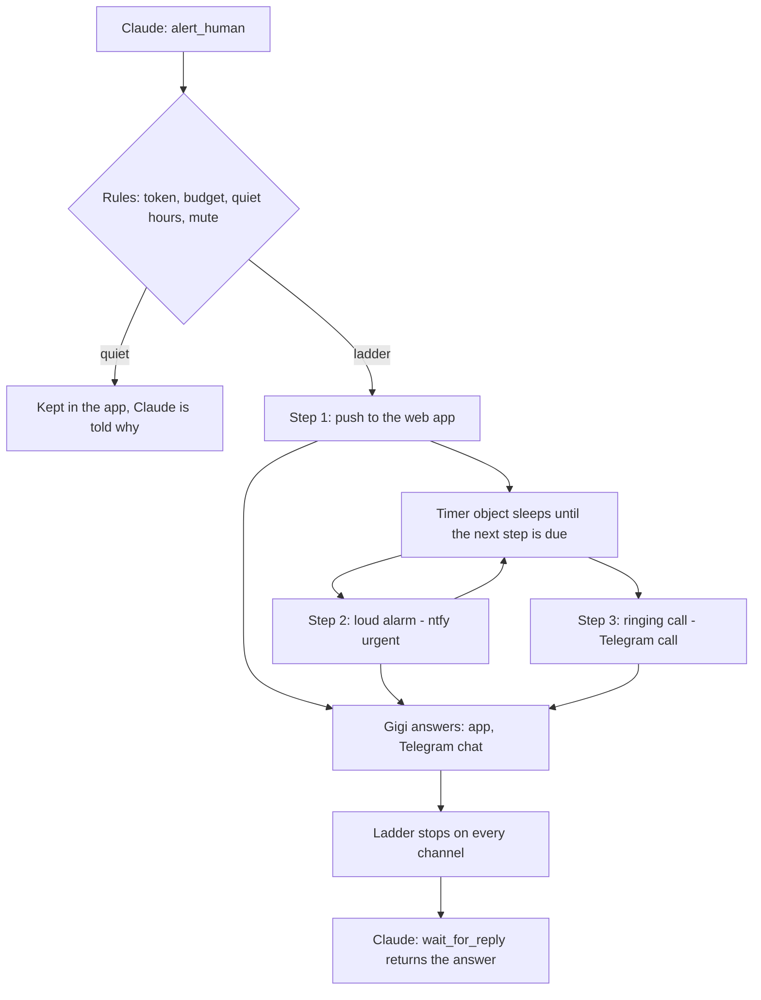

# Rouse system plan

The plan for [[Rouse]], written 2026-11-10 at Gigi's request. Reading version: https://claude.ai/artifact/5w5RtsHstt8PmzdjcBR1w2 (private to Gigi). Nothing here is built yet.

## Flow

## Urgency
| Urgency | Default ladder |
|---|---|
| info | One quiet push, never climbs |
| important | Push, then a loud alarm after 2 minutes, twice |
| critical | Push and alarm at once, a call after 60 seconds, repeating for 15 minutes at most |

In quiet hours only critical makes noise.

## Channels (checked 2026-11-10 on each service's own page)
| Channel | Cost | Notes |
|---|---|---|
| Own web app push | Free | Reply buttons. Obeys silent mode. On iPhone the app must be on the home screen |
| ntfy urgent | Free | Android alarm that can pass Do Not Disturb. iPhone critical alerts are not finished in ntfy. Public server, so random topic and no private text |
| Telegram bot message | Free | Reply buttons in the chat |
| Telegram call through CallMeBot | Free | Rings 30 seconds. Shared queue. Spoken text is silent on iPhone, it still rings |
| Pushover emergency | 4.99 USD once per phone type, 30 day trial | The only cheap way through silent mode on an iPhone |
| Twilio call or SMS | Paid per use | The trial reaches only verified numbers in the sign-up country and has no custom SMS text |
| Own Android alarm app | Free | Phase 6. The iPhone version needs a paid Apple account and a Mac |

## Parts
| Part | Runs on |
|---|---|
| MCP endpoint `/mcp` (stateless, `createMcpHandler`) | Worker |
| Sign-in for Claude (OAuth, one revocable token per agent) | Worker, `workers-oauth-provider`, KV |
| Rules and ladder engine | Worker |
| Timer for the next step | One Durable Object, alarms only |
| Alerts, steps, replies, devices, rules | D1 |
| Channel adapters, one small module each | Worker, outbound HTTPS |
| Phone web app (answer page, history, mute, settings) | React and Tailwind, same Worker |
| Incoming hooks (Telegram, Pushover) | Worker `/hooks/` |

Secrets (Telegram bot token, push signing key, session pepper, any paid keys) live only in Worker secrets.

## Tools
`alert_human`, `wait_for_reply` (holds up to 25 seconds per call), `get_alert`, `cancel_alert`, `list_alerts`, `check_availability`.

## Safety rules
- Hourly budget per token and urgency; over it, alerts are downgraded and Claude is told.
- One mute switch; duplicates fold together; every ladder ends (15 minutes at most).
- One hashed, labelled, revocable token per connected agent. Gigi signs in with a passkey. (Changed 2026-11-12: people sign in with an email and a password, see [[ADR-0023 Rouse accounts use email, password and recovery codes]].)
- Outside services get "Claude needs you" and a link, never the message text.
- A link from an outside service only opens the alert; answering needs the signed-in app or Gigi's own Telegram chat.
- All text is length-limited plain text. Every alert shows which agent sent it.
- Hooks carry a shared secret. Sign-in, answer page and hooks are rate limited in the app (Knotwork already uses the zone's one WAF rate rule, see [[Cloudflare]]).
- Paid channels are off by default with a hard monthly cap.

## Phases
| Phase | Result |
|---|---|
| 0 Foundations | Empty app live on its subdomain, deploying itself; measurements taken |
| 1 First ring | Alert reaches the phone, the answer returns to Claude |
| 2 Loud ladder | Timer, ntfy, Telegram message and call, stop on answer |
| 3 Rules | Editable ladders, quiet hours, budgets, mute, history |
| 4 Open to others | Accounts, demo, landing page, docs (accounts came early, 2026-11-12) |
| 5 Paid channels (optional) | Pushover and Twilio with the user's own keys |
| 6 Android alarm app (stretch) | Full-screen alarm |
| 7 Portfolio | Case study on [[gigiberidze.com]] |

## To measure in phase 0
CPU per web push, Durable Object running time per alert against the free allowance, D1 reads per waiting minute, and whether Claude's connector allows a 25 second tool call. The free-plan numbers for Durable Objects were not read from Cloudflare's pricing page yet.

## Risks
- An iPhone on silent sleeps through the free channels.
- The free call service is shared and can be slow or down; it must never be the only loud step.
- Battery savers delay pushes; setup needs a test button per channel.
